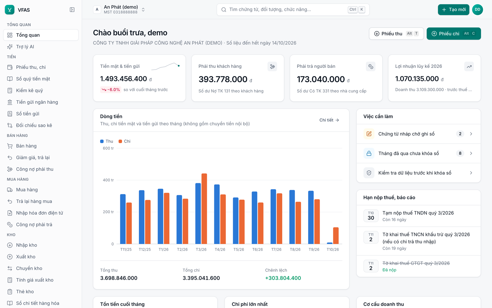
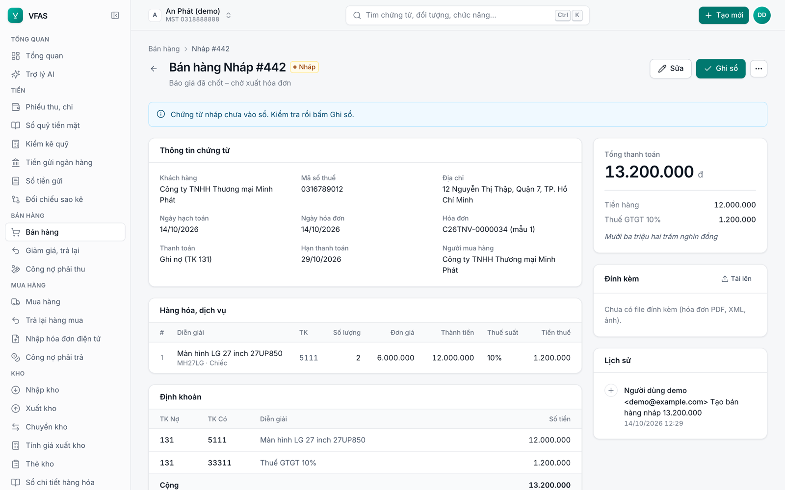
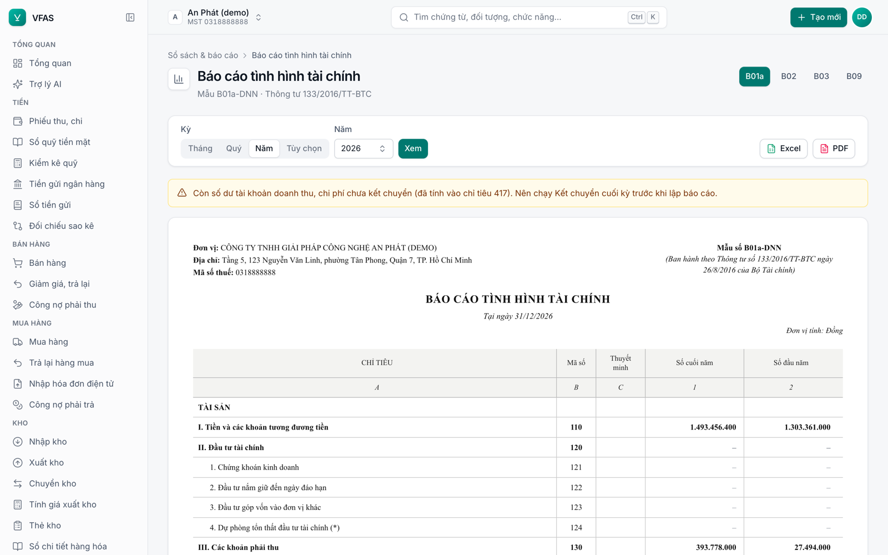
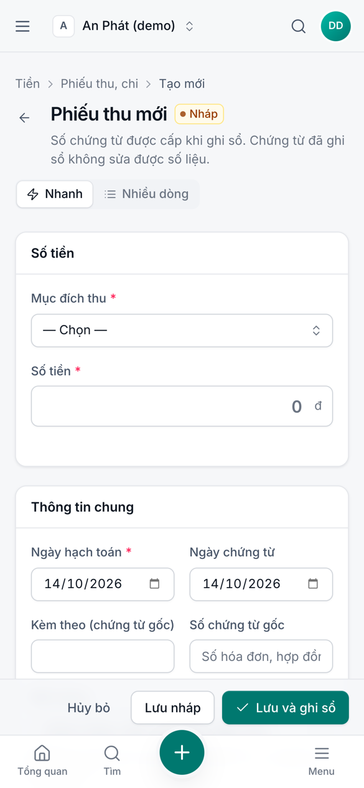
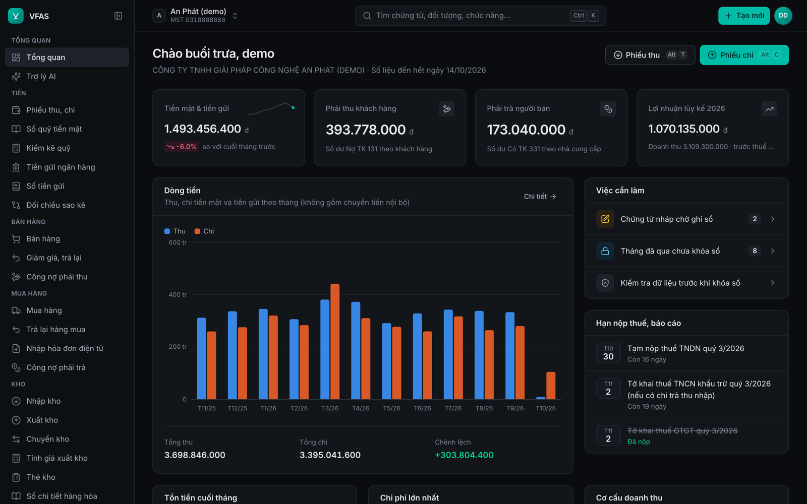

<div align="center">


# VFAS

**Vietnam Free Accounting Software**<br>
Phần mềm kế toán **miễn phí, mã nguồn mở** cho doanh nghiệp nhỏ và vừa Việt Nam – chế độ kế toán Thông tư 133/2016/TT-BTC

[](https://github.com/nviai/vfas/actions/workflows/ci.yml)
[](LICENSE)
[](https://www.python.org/)
[-261230)](CONTRIBUTING.md#code-style)
[](https://fastapi.tiangolo.com/)
[](docs/DECISIONS.md)
[](docs/DEPLOY.md#4-postgresql)
[](CONTRIBUTING.md)

[Tính năng](#tính-năng) · [Dùng thử](#dùng-thử-trong-2-phút) · [Cài đặt](#cài-đặt-cho-doanh-nghiệp) ·
[Tài liệu](#tài-liệu) · [Đóng góp](#đóng-góp) · [English](README.md)

<picture>
  <source media="(prefers-color-scheme: dark)" srcset="docs/images/dashboard-dark.png">
  
</picture>

</div>

## Vì sao có VFAS

- **Miễn phí và mở** – không thu phí bản quyền, không giới hạn số chứng từ hay người dùng. Mã nguồn công khai theo
  MIT: ai cũng kiểm tra được phần mềm tính thuế, lập báo cáo thế nào, và được dùng lại mã nguồn.
- **Dữ liệu là của bạn** – tự cài trên máy chủ của mình hoặc chạy dạng SaaS; xuất toàn bộ dữ liệu một công ty bất cứ lúc nào.
- **Sổ sách sạch** – chứng từ đã ghi sổ không sửa được số liệu, không xóa được (chặn cả ở tầng cơ sở dữ liệu); sửa sai
  bằng hủy có lý do hoặc chứng từ điều chỉnh; nhật ký thao tác không xóa được.
- **Đúng chế độ** – mẫu sổ, BCTC theo TT133, tờ khai 01/GTGT, thuế TNCN, bảo hiểm với tham số có ngày hiệu lực.
- **AI agent theo chuẩn OpenAI** – hỏi số liệu bằng tiếng Việt, lập chứng từ nháp; dùng Claude, OpenAI, OpenRouter hoặc
  Ollama tự host. AI chỉ lập nháp, người có quyền mới ghi sổ.
- **Nhẹ** – chạy trên VPS 1 GB với SQLite, hoặc PostgreSQL nhiều tiến trình cho SaaS; một lệnh Docker.

## Ảnh chụp màn hình

| Chứng từ bán hàng | Báo cáo tình hình tài chính B01a-DNN |
|---|---|
|  |  |

| Phiếu thu trên điện thoại | Giao diện tối |
|---|---|
|  |  |

## Tính năng

| Nhóm | Nội dung |
|---|---|
| **Sổ cái, báo cáo** | Bút toán kép, phiếu kế toán, số dư đầu kỳ (nhập Excel), Sổ Nhật ký chung S03a-DNN, Sổ Cái S03b-DNN, sổ chi tiết tài khoản, Bảng cân đối tài khoản F01-DNN, BCTC B01a-DNN, B02-DNN, B03-DNN, B09-DNN; kết chuyển cuối kỳ; khóa sổ tháng/năm |
| **Tiền mặt** | Phiếu thu 01-TT, phiếu chi 02-TT (form nhanh cho thủ quỹ trên điện thoại), sổ quỹ S04a/S04b-DNN, kiểm kê quỹ 08a-TT, nhập sổ quỹ cũ từ Excel |
| **Ngân hàng** | Thu/chi tiền gửi, chuyển tiền nội bộ, sổ tiền gửi S05-DNN, ủy nhiệm chi, nhập sao kê CSV/XLSX, tự đối chiếu |
| **Mua bán** | Hàng hóa/dịch vụ, chứng từ bán hàng, mua hàng, trả lại/giảm giá, **nhập hóa đơn điện tử XML** (file lẻ hoặc ZIP) |
| **Thuế** | Bảng kê mua vào/bán ra, tờ khai **01/GTGT** (PDF, Excel, XML theo cấu trúc HTKK), phụ lục giảm thuế 8%, bảng tính TNDN, lịch nộp thuế |
| **Công nợ** | Phải thu/phải trả theo đối tượng, sổ chi tiết thanh toán, tuổi nợ, biên bản đối chiếu công nợ |
| **Kho** | Nhiều kho, nhập/xuất/chuyển kho, giá xuất bình quân gia quyền cả kỳ, thẻ kho, tổng hợp nhập–xuất–tồn |
| **Tài sản** | TSCĐ (thẻ, sổ, khấu hao đường thẳng, ghi giảm), CCDC / chi phí trả trước (phân bổ) |
| **Lương** | Hồ sơ nhân viên, bảng lương tháng, BHXH/BHYT/BHTN/KPCĐ, thuế TNCN, phiếu lương, trả lương |
| **Trợ lý AI** | Hỏi số liệu bằng tiếng Việt, lập chứng từ **nháp**, công cụ lọc theo quyền người hỏi |
| **API** | REST `/api/v1`, token theo công ty, endpoint tương thích OpenAI (`/api/v1/chat/completions`, `/api/v1/tools`) |
| **Hệ thống** | Nhiều công ty, 5 vai trò, mời thành viên, nhật ký thao tác, kiểm tra dữ liệu, sao lưu/khôi phục (mã hóa tùy chọn) |
| **Giao diện** | Sáng/tối, điện thoại, Tiếng Việt/English, Ctrl+K tìm mọi thứ, phím tắt nhập liệu |

**Nguyên tắc dữ liệu**
- **Không âm:** tiền mặt, từng tài khoản ngân hàng và tồn kho không âm tại bất kỳ thời điểm nào, kể cả khi ghi lùi ngày.
- **Một nguồn số liệu:** mọi sổ, báo cáo, tờ khai đọc từ sổ cái; có kiểm tra chéo (F01 cân, tài sản = nguồn vốn, kho = TK 15x…).
- **Phân quyền chặt:** dữ liệu lương chỉ người có quyền mới thấy; các công ty trên cùng hệ thống tách biệt hoàn toàn.

## Dùng thử trong 2 phút

Cần Docker:

```bash
git clone https://github.com/nviai/vfas.git && cd vfas
docker build -t vfas .
docker run -d --name vfas -p 127.0.0.1:8000:8000 -v vfas-data:/data vfas
docker exec vfas python -m app.cli demo
```

Mở <http://127.0.0.1:8000> và đăng nhập `demo@example.com` / `Demo@2026`. Công ty mẫu có khoảng một năm nghiệp vụ.
Dọn dẹp: `docker rm -f vfas && docker volume rm vfas-data`.

## Cài đặt cho doanh nghiệp

| | Self-host (một công ty) | Cloud / SaaS (nhiều công ty) |
|---|---|---|
| Máy chủ | VPS 1 GB hoặc máy trong LAN | VPS 2–4 GB trở lên |
| CSDL | SQLite | PostgreSQL |
| Truy cập | HTTPS qua reverse proxy hoặc VPN | HTTPS qua Traefik, rate limit tại proxy |
| Đăng ký | Quản trị mời thành viên | Tự đăng ký (cần SMTP – đang làm) |

Hướng dẫn đầy đủ: [docs/DEPLOY.md](docs/DEPLOY.md). Trước khi đưa lên Internet, làm theo checklist trong
[docs/SECURITY-GUIDE.md](docs/SECURITY-GUIDE.md).

## Chạy từ mã nguồn

Cần Python 3.12 và [uv](https://docs.astral.sh/uv/). Tailwind CSS dùng bản standalone, không cần Node.

```bash
make setup && make tailwind && make css     # venv + thư viện, Tailwind CLI, build CSS
make migrate && .venv/bin/python -m app.cli demo
make dev                                    # http://127.0.0.1:8000
make test                                   # pytest: unit, nghiệp vụ, web, tích hợp
make e2e                                    # E2E trên trình duyệt thật (Playwright)
make lint                                   # PEP 8 (ruff) + chú thích tiếng Anh
```

**Kiến trúc:** `app/core` là hạ tầng (đa công ty, phân quyền, registry, trigger, giao diện); mỗi module trong
`app/features/<module>` tự khai báo route, model, quyền, menu, công cụ AI và kiểm tra dữ liệu, được nạp tự động.

**Stack:** Python 3.12 · FastAPI · SQLAlchemy 2 + Alembic · Jinja2 + HTMX + Alpine.js · Tailwind CSS v4 · WeasyPrint ·
openpyxl · SQLite/PostgreSQL.

## Tài liệu

Tài liệu chi tiết viết bằng tiếng Anh.

| Tài liệu | Nội dung |
|---|---|
| [docs/DEPLOY.md](docs/DEPLOY.md) | Cài đặt, biến môi trường, PostgreSQL, cập nhật, sao lưu, lệnh quản trị |
| [docs/USAGE.md](docs/USAGE.md) | Vai trò và quyền, trợ lý AI, API kiểu OpenAI, phím tắt |
| [docs/SECURITY-GUIDE.md](docs/SECURITY-GUIDE.md) | Mô hình bảo mật, kết quả review, checklist cloud và self-host |
| [docs/EINVOICE.md](docs/EINVOICE.md) | Nghiên cứu và thiết kế xuất hóa đơn điện tử qua nhà cung cấp |
| [docs/PLAN.md](docs/PLAN.md) | Kế hoạch sản phẩm, kiến trúc |
| [docs/MODULES.md](docs/MODULES.md) · [docs/CONTRACTS.md](docs/CONTRACTS.md) · [docs/UI.md](docs/UI.md) | Đặc tả module, giao kèo lõi–module, design system |
| [docs/DECISIONS.md](docs/DECISIONS.md) | Quyết định thiết kế và nguồn pháp lý đã đối chiếu |
| [docs/PROGRESS.md](docs/PROGRESS.md) | Tiến độ và các tầng kiểm thử |
| [CHANGELOG.md](CHANGELOG.md) | Lịch sử thay đổi |

## Lộ trình

- [ ] Gửi email (SMTP): xác minh email, quên mật khẩu, gửi lời mời – cần có trước khi mở đăng ký công khai
- [ ] Xuất hóa đơn điện tử qua nhà cung cấp (Viettel S-Invoice, MISA meInvoice, VNPT, BKAV) – thiết kế ở [docs/EINVOICE.md](docs/EINVOICE.md)
- [ ] XML BCTC, 03/TNDN, 05/QTT-TNCN để nộp qua HTKK
- [ ] Chế độ kế toán TT99/2025 và TT58/2026 (điểm mở rộng `app/core/regimes.py`)
- [ ] Ngoại tệ, kết nối API ngân hàng, giá thành sản xuất
- [ ] Image Docker dựng sẵn

Muốn nhận một mục? Mở issue để thảo luận trước khi làm.

## Đóng góp

Mọi đóng góp đều quý: báo lỗi, sửa code, dịch, viết tài liệu, và đặc biệt là **kế toán viên đối chiếu mẫu sổ, cách hạch
toán với văn bản pháp luật**. Đọc [CONTRIBUTING.md](CONTRIBUTING.md) và [Quy tắc ứng xử](CODE_OF_CONDUCT.md) trước khi
gửi pull request. Issue và thảo luận viết tiếng Việt được; code, chú thích và tài liệu viết tiếng Anh, Python theo PEP 8.

## Bảo mật

Phát hiện lỗ hổng? **Đừng mở issue công khai** – báo riêng theo [SECURITY.md](SECURITY.md).

## Lưu ý pháp lý

- Phần mềm cung cấp "nguyên trạng", không kèm bảo hành (xem [LICENSE](LICENSE)). Người quản lý, kế toán trưởng chịu
  trách nhiệm về tính chính xác của số liệu (Điều 28 Thông tư 99/2025/TT-BTC); nên để kế toán trưởng duyệt báo cáo
  trước khi nộp.
- **XML tờ khai 01/GTGT** dựng theo cấu trúc HTKK phổ biến, chưa đối chiếu được với XSD chính thức: **mở bằng HTKK để
  kiểm tra trước khi nộp**.
- Một số mã mẫu sổ (S06/S07/S08/S09/S11-DNN, 02-LĐTL, 06-TSCĐ…) lấy theo nguồn tư vấn, cần đối chiếu văn bản gốc TT133.
- Tham số lương/thuế đã kiểm theo nguồn công khai tháng 10/2026 và **sửa được** ở Lương → Tham số khi luật đổi.

## Giấy phép

VFAS phát hành theo [giấy phép MIT](LICENSE). Bản quyền © 2026 NVIAI CO., LTD.

Tóm tắt, không thay thế văn bản giấy phép: bạn được dùng, sao chép, sửa đổi, gộp, công bố, phân phối, cấp phép lại và
bán VFAS, kể cả trong sản phẩm thương mại hoặc mã nguồn đóng, miễn là giữ thông báo bản quyền và văn bản giấy phép.
Phần mềm không kèm bất kỳ bảo hành nào.

## Ghi nhận

VFAS được xây trên [FastAPI](https://fastapi.tiangolo.com/), [SQLAlchemy](https://www.sqlalchemy.org/),
[Alembic](https://alembic.sqlalchemy.org/), [Jinja2](https://jinja.palletsprojects.com/), [HTMX](https://htmx.org/),
[Alpine.js](https://alpinejs.dev/), [Tailwind CSS](https://tailwindcss.com/), [WeasyPrint](https://weasyprint.org/),
[openpyxl](https://openpyxl.readthedocs.io/), icon [Lucide](https://lucide.dev/) (ISC) và font
[Inter](https://rsms.me/inter/) (SIL OFL).
